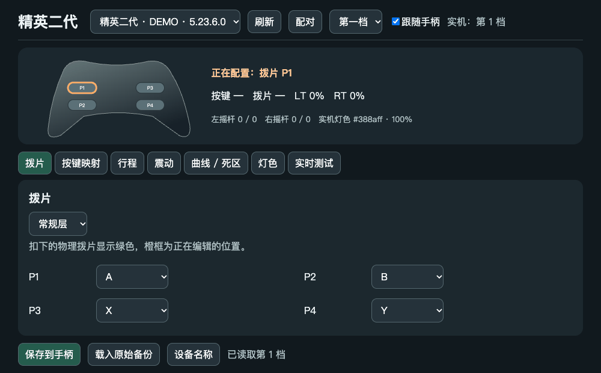
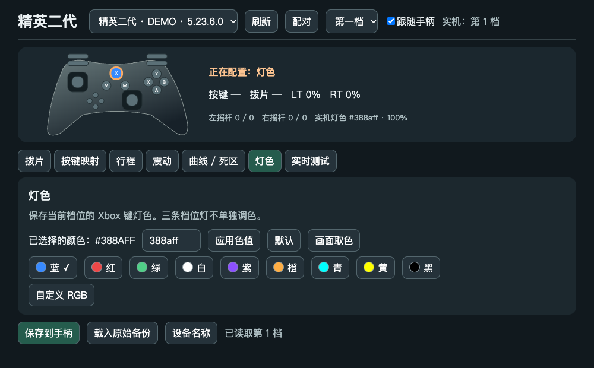
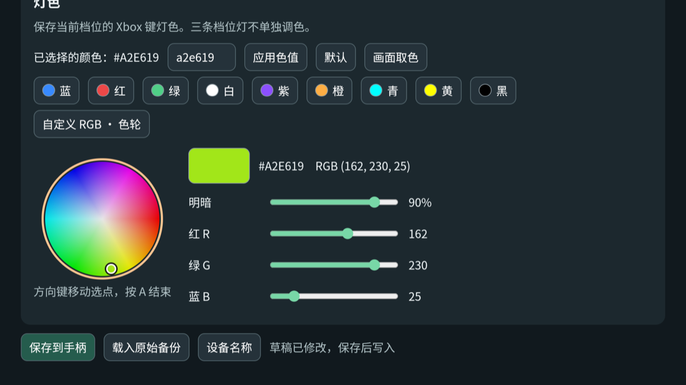
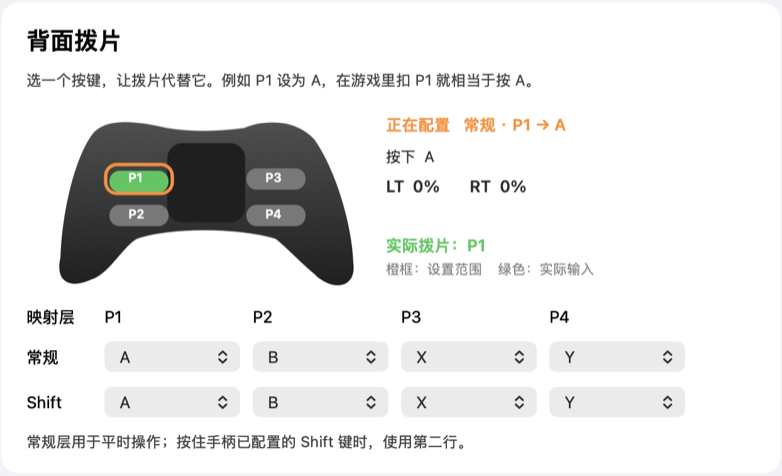

<p align="center"></p>

# ElitePad Studio · 精英手柄配置

通过微软 Xbox Wireless Adapter，在 **Mac 或树莓派 5 Android TV** 上调整 Xbox Elite Wireless Controller Series 2 的三个板载档位。把 P1 映射成 A、给赛车档换上蓝色 Xbox 键灯，或在实时测试里确认 RT 能否踩到 100%。保存后，配置随手柄带走。

**[下载最新版本](https://github.com/Clierbin/ElitePadStudio/releases/latest)** · [Mac 安装](#macos) · [树莓派升级](#raspberry-pi) · [从源码构建](#build)

## 看一次实际操作会怎样显示



上图用**示例输入驱动项目实际的电视界面**。橙框标出你正在编辑的位置，绿色随输入报告变化。例如编辑 P1 时扣下 P3，橙框仍留在 P1，P3 会亮绿。切到「实时测试」后，可同时看按键、两侧扳机百分比和摇杆坐标。

| 想调整什么 | 在手柄上会有什么变化 |
| --- | --- |
| 拨片与按键映射 | 分别设定常规层与 Shift 层。比如把 P1 设成 A，扣 P1 就会发出 A；按住手柄原有的 Shift 修饰键可调用第二层。 |
| 行程与摇杆曲线 | 缩短满输入行程，扳机或摇杆会更早达到最大输入。曲线控制推杆距离和输出量的关系，也能用曲线设置中心死区。 |
| 震动强度 | 分开调整左右握把和两个扳机马达。「实时测试」可让选中的马达短震一次，方便认出位置。 |
| 档位与灯色 | 三个自定义档各自保存 Xbox 键的 RGB 颜色，支持六位色值、预设色和取色。三条白色档位指示灯用于辨认档位。 |
| 设备名称 | 修改整只手柄的蓝牙广播名，三个档位共用这个名字。 |



电视端用方向键移到颜色按钮，按 A 后「已选择的颜色」和勾选标记会立即更新；需要微调时打开「自定义 RGB」。选好后点「保存到手柄」才会写入。图中第一档的示例灯色是 `#388AFF`。开启「跟随手柄」后，用实体档位键切换第 1–3 档，编辑器会读取对应配置；开始编辑后会暂停跟随。默认档仅供查看。固件尚未报告的输入或灯色会显示等待或未知。

打开「自定义 RGB · 色轮」，聚焦圆盘后按 A，用方向键移动白色选点，再按 A 退出移动。圆心到边缘控制饱和度，「明暗」滑块可调出深色；右侧色样、十六进制和 RGB 数值会同步更新。也支持在圆盘中点击或拖动。



## 安装与第一次使用

<a id="macos"></a>
### Mac · Apple Silicon



图为 Mac 原生面板的局部示例：当前正在编辑 P1，示例输入同时点亮了 P1，并在右侧显示它映射出的 A。

1. 在 [Releases](https://github.com/Clierbin/ElitePadStudio/releases/latest) 下载文件名含 **macOS-arm64** 的 ZIP，解压后将 `ElitePadStudio.app` 拖入「应用程序」。预编译版面向 macOS 13 或更新版本，调用系统的 `/usr/bin/python3`；如系统提示安装 Command Line Tools，请先完成安装。应用使用本地临时签名，未经 Apple 公证。
2. 把微软无线接收器插入 Mac，退出正在使用接收器的 GamepadBridge 或旧控制台。首次打开应用，选择你已有的微软接收器固件 `FW_ACC_00U.bin`。校验通过后应用会将它保存在当前用户目录，以后无需再选。
3. 按手柄正面的 Xbox 键开机，选中手柄和目标档位。首次配对时点「无线配对」，再按手柄顶部配对键，等 Xbox 键常亮。
4. 调整配置，点「保存」并确认档位。写入前会备份，写完会读回核对。配置结束后退出编辑器，即可重新打开 GamepadBridge。

<a id="raspberry-pi"></a>
### 树莓派 5 · Android TV

Release 中的 **Pi5-AndroidTV-r4-upgrade** ZIP 用于升级已有 r4 游戏驱动的树莓派。需要原机已安装接收器固件、libusb 和 `xbox_pi5` 开机服务，系统支持 `adb root`。全新 Android TV 系统请先核对这些前提；单独安装 APK 无法驱动接收器。

在 Mac 解压升级包，进入含 `scripts` 和 `dist` 的目录。把下面的地址替换成电视网络设置里显示的 IP，退出正在使用手柄的游戏：

```bash
export ANDROID_SERIAL="树莓派IP:5555"
adb connect "$ANDROID_SERIAL"
adb -s "$ANDROID_SERIAL" root
adb connect "$ANDROID_SERIAL"
adb -s "$ANDROID_SERIAL" wait-for-device
bash scripts/upgrade-pi.sh
adb -s "$ANDROID_SERIAL" unroot
```

升级时手柄会短暂断开。打开电视桌面的「精英手柄配置」，用方向键移动焦点、A 键确认，也可使用鼠标。多只手柄在线时先从顶部选择目标手柄。APK 沿用开发签名；覆盖安装要求与原包签名一致，清除应用数据会删除电视端备份。

**要回退游戏驱动**，按上面的步骤恢复 ADB root 并重新连接，然后运行 `bash scripts/upgrade-pi.sh rollback`，完成后再执行 `adb -s "$ANDROID_SERIAL" unroot`。回退使用升级时保留的原 r4 驱动；档位编辑器依赖新版服务。

<a id="build"></a>
## 从源码构建

| 目标 | 构建环境 | 命令与产物 |
| --- | --- | --- |
| macOS | Mac、Xcode Command Line Tools、Python 3 | `bash scripts/build-mac.sh` → `dist/ElitePadStudio.app`。公开构建时保持 `XBOX_FIRMWARE` 未设置，应用首次运行会提示导入。 |
| 树莓派 Android TV | Mac、Android SDK Platform 34、Build Tools 34.0.0、JDK 11、NDK r27d、CMake 3.20+ | 设置 `ANDROID_SDK_ROOT`、`ANDROID_NDK_ROOT` 后运行 `bash scripts/build-pi.sh` → `dist/xow` 和 `dist/elite-profiles.apk`。脚本使用本机已有的 `~/.android/debug.keystore`。 |

## 兼容范围与验证

已识别精英二代产品 ID `0b00`、手柄固件 `5.23.6.0`。树莓派实机验收覆盖单只手柄的实时输入，以及三个档位共 12 页配置连续两次读取一致。该次验收没有写入档位，也没有重新验证断电和拔插。本文动图用于展示界面反馈，不能用来测量无线延迟。

```bash
python3 macos/tests/test_advanced.py
c++ -std=c++17 tests/test_paddles.cpp -o /tmp/test-elite-input
/tmp/test-elite-input
```

Mac 客户端位于 [macos/](macos/)，电视界面和本地通信位于 [android/](android/)，接收器驱动和开机服务位于 [pi/](pi/)。[只读探针](tests/readonly_probe.py) 可通过 ADB 转发到 `localabstract:pi5.elite.profiles.v1` 核对在线手柄的配置页。公开诊断日志前请移除无线地址及序列号。

本项目为非官方开源工具。微软接收器固件由使用者自行提供。项目及上游组件的许可和致谢见 [LICENSE](LICENSE)、[NOTICE.md](NOTICE.md) 和 [licenses/](licenses/)。
